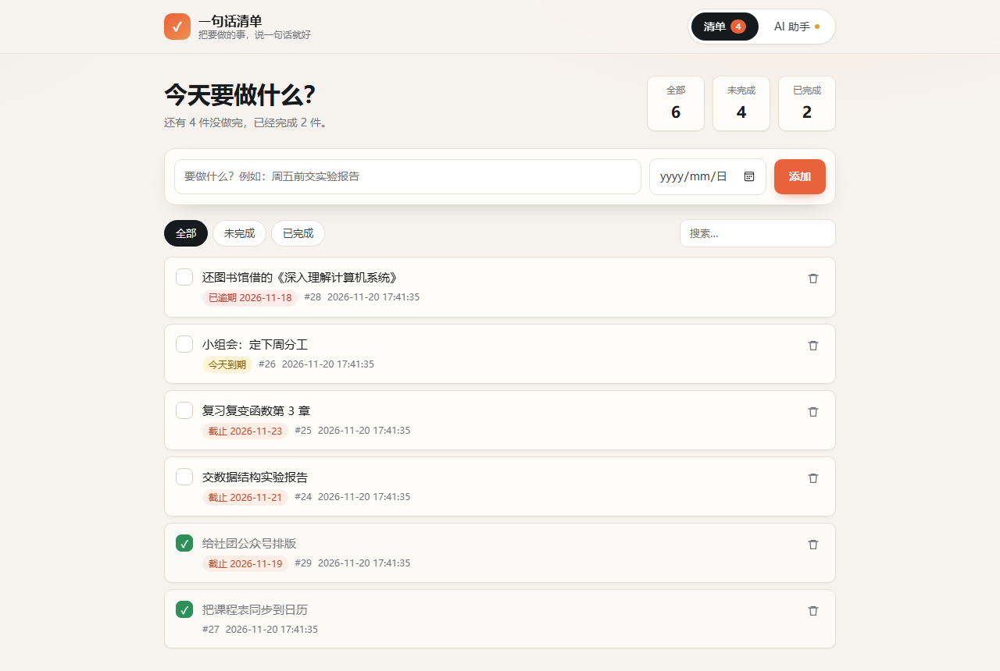
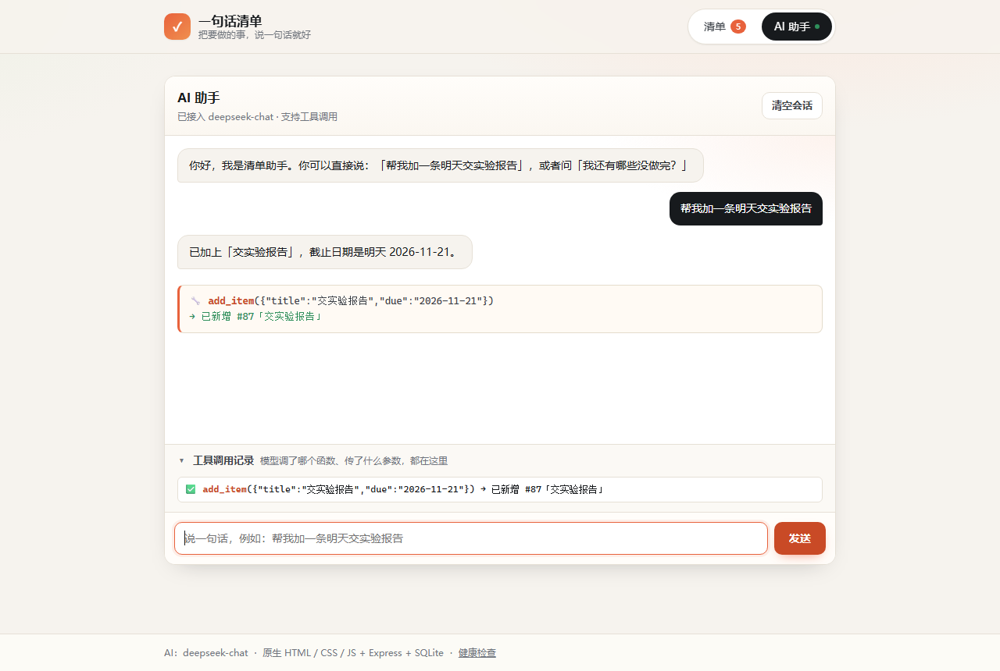
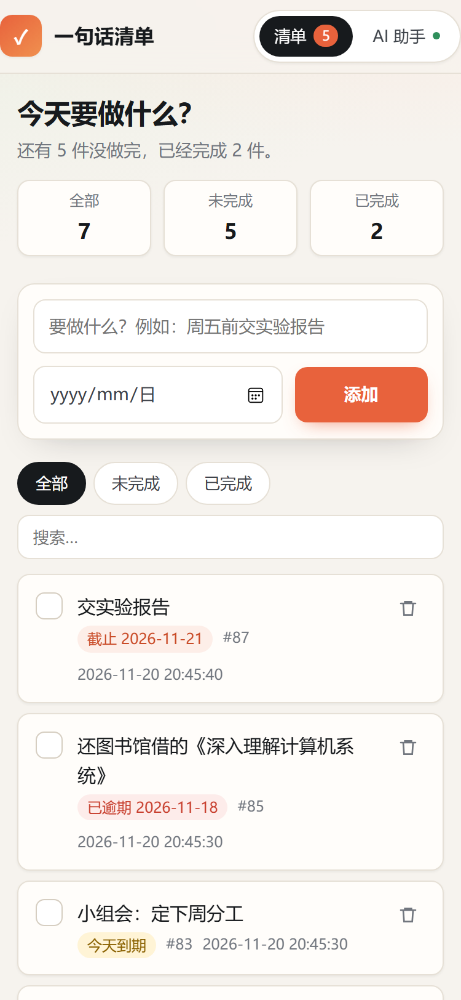
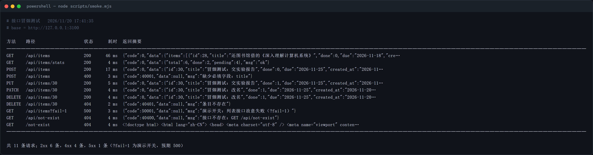

# 一句话清单 · OneList

> 26 级第五阶段 · 完善 Web + AI 应用
> 一个能听懂人话的待办清单：原生前端 + Express + SQLite + 大模型工具调用。

**一句话说明**：手动能加删改查，动嘴也能——说「帮我加一条明天交实验报告」，模型会**真的**去数据库里插一条，然后把结果说给你听。

| 项 | 地址 |
|---|---|
| 仓库 | https://github.com/Y-yanxia/web-phase5-yyx |
| 线上页面 | https://y-yanxia.github.io/web-phase5-yyx/ （GitHub Pages，静态托管） |
| 线上接口 | 部署后填这里：`https://<你的服务>.onrender.com` |
| 本地 | http://localhost:3000 |

> ⚠️ 当前状态：AI 处于**离线演示模式**（没有配置 `DEEPSEEK_API_KEY`，工具调用由规则模拟）；
> 后端尚未部署，所以 Pages 上打开会看到「线上后端还没部署」的提示（见 `docs/evidence/13-pages-live.png`）。
> 这两步都只需要配环境变量，代码不用改：Key 见 [`docs/ai-setup.md`](docs/ai-setup.md)，部署见 [`docs/deploy.md`](docs/deploy.md)。

---

## 1. 这个项目解决什么问题

每天的任务散在微信群、备忘录、脑子里，最大的问题是**记下来这一步太麻烦**。打开 App → 找输入框 → 打字 → 选日期，四步换一条记录。

这个项目把「记一条」压缩成一句话：**说人话，模型负责转成结构化数据并落库**。
同时保留完整的手动操作，不依赖 AI 也能当一个正常的待办清单用。

四条核心能力：

1. **清单 CRUD**：新增 / 勾选完成 / 删除 / 按状态筛选 / 关键词搜索。
2. **三态可见**：加载中（骨架屏）、空清单、出错（带重试按钮），不会白屏。
3. **流式对话**：AI 回复逐字出现，可随时「停止生成」，停止后服务端会真的掐断上游请求。
4. **工具调用**：`add_item` / `query_items` / `complete_item` 三个工具，模型决定调哪个、传什么参数，后端执行后把结果回填，模型再用自然语言总结。前端有**工具调用记录**面板，能看见函数名和参数。

---

## 2. 技术栈

| 层 | 选型 | 为什么 | 备选 |
|---|---|---|---|
| 页面 | 原生 HTML / CSS / JS | 任务书硬限制；也想知道 DOM、fetch、事件到底怎么工作 | —— |
| 后端 | Node 24 + Express 4 | 生态熟、SSE 转发简单、异步错误可控 | FastAPI |
| 数据库 | SQLite（`node:sqlite` 内置模块） | 单文件即库、免编译原生模块，免费容器里不会装包失败 | better-sqlite3 / JSON 文件 |
| 模型 | DeepSeek `deepseek-chat`（OpenAI 兼容） | 国内直连、支持 tools、流式稳定 | 智谱 GLM-4 |
| 部署 | 前端 GitHub Pages + 后端 Render | 都在免费额度内；前端纯静态，后端长连接跑 SSE | Vercel + Railway |

**为什么不用框架**：这周的目标是讲清楚「一次请求从点击到渲染」的全过程。Vue/React 会把 fetch、状态、渲染藏起来，答辩时讲不出细节。

---

## 3. 快速开始（10 分钟）

### 3.1 环境要求

- **Node.js >= 24**（用了内置 `node:sqlite`，22 以下需要加 `--experimental-sqlite`）
- 一个现代浏览器（Chrome / Edge）

```bash
node -v   # 应该是 v24.x
```

### 3.2 三步跑起来

```bash
# 1. 装依赖（只有 express 一个运行时依赖）
npm install

# 2. 准备环境变量（不配 Key 也能跑，会自动进入离线演示模式）
cp .env.example .env        # Windows PowerShell: Copy-Item .env.example .env

# 3. 启动
npm start
```

打开 <http://localhost:3000>，看到清单页就成功了。

首次启动会在 `data/app.db` 自动建表，不需要手动执行任何 SQL。

想先塞几条演示数据：

```bash
npm run seed
```

### 3.3 环境变量

| 变量 | 必填 | 默认 | 说明 |
|---|---|---|---|
| `PORT` | 否 | `3000` | 服务端口；Render 会自动注入 |
| `DB_FILE` | 否 | `data/app.db` | SQLite 文件位置，`:memory:` 用于测试 |
| `DEEPSEEK_API_KEY` | 否 | 空 | 空 = 离线演示模式；填了 = 真实模型 |
| `DEEPSEEK_MODEL` | 否 | `deepseek-chat` | 别用 reasoner，工具调用支持不完整 |
| `DEEPSEEK_BASE_URL` | 否 | `https://api.deepseek.com` | OpenAI 兼容协议地址 |
| `ALLOWED_ORIGINS` | 否 | 本地 3000/5173 | 允许跨域的前端来源，逗号分隔 |
| `HISTORY_LIMIT` | 否 | `8` | 保留多少条历史消息（超了丢最早的） |
| `NODE_ENV` | 否 | `development` | `production` 会关闭 `?fail=1` 演示开关 |

> `.env` 已在 `.gitignore` 第一行，**永远不会进仓库**。仓库里只有 `.env.example`（值为空）。

---

## 4. 页面与功能

### 4.1 清单页

- 顶部三个统计：全部 / 未完成 / 已完成。
- 添加表单：标题必填（前端 + 后端双重校验）、截止日期可选。
- 筛选（全部/未完成/已完成）+ 关键词搜索，都会带参数重新请求接口，不是本地过滤。
- 每条任务：勾选框、截止日期标签（逾期红色 / 今天黄色）、删除按钮。
- 三态：骨架屏 → 空状态 / 错误 + 重试。



### 4.2 AI 助手页

- 对话气泡 + 流式打字效果。
- 三个示例问法直接可点（不，是直接可照着说）。
- **工具调用卡片**：对话流里直接显示 `🔧 add_item({"title":"明天交实验报告"})` 和执行结果。
- **工具调用记录**面板：每次调用的函数名、参数、结果，答辩时对着它讲。
- 「停止生成」按钮：点一下，前端 abort、后端 `res.on('close')` 掐断上游。



### 4.3 手机端（375px）

`document.documentElement.scrollWidth === 375`，无横向滚动条，已实测并截图。



---

## 5. 接口

完整文档（含每个参数的校验规则、错误码表）见 [`docs/api.md`](docs/api.md)。

统一返回格式：

```json
{ "code": 0, "data": {}, "msg": "ok" }
```

| 方法 | 路径 | 说明 |
|---|---|---|
| GET | `/api/items?done=0&q=实验&limit=50` | 列表，支持状态过滤 + 关键词 |
| GET | `/api/items/stats` | 统计（total / done / pending） |
| POST | `/api/items` | 新增，body: `{title, due?}` |
| PUT / PATCH | `/api/items/:id` | 更新 `title` / `done` / `due` |
| DELETE | `/api/items/:id` | 删除 |
| POST | `/api/chat` | SSE 流式对话，body: `{sessionId, message}` |
| GET | `/api/chat/meta` | 当前是 live 还是 mock |
| DELETE | `/api/chat/session/:id` | 清空会话历史 |
| GET | `/api/health` | 健康检查（含模式、运行时长、统计） |

命令行验收（会自动生成一张对齐的表格）：

```bash
npm start            # 另开一个窗口
npm run smoke        # 输出 docs/evidence/api-smoke.txt
```



---

## 6. AI 的两种模式

| 模式 | 触发条件 | 行为 | 用途 |
|---|---|---|---|
| `live` | 配了 `DEEPSEEK_API_KEY` | 真调 DeepSeek：SSE 流式 + `tools` 双轮循环 | 正式演示 / 答辩 |
| `mock` | 没配 Key 或 `MOCK_AI=1` | 规则模拟：正则判断意图 → 调同一个 `executeTool` → 拼自然语言；同样维护多轮上下文，能消解「把它勾掉」里的代词 | 无网络/无额度时也能跑通全链路 |

**关键点**：两种模式走的是**同一套工具执行器和同一张表**。mock 只替换「模型」这一层，数据链路完全一样。所以没 Key 时，截图里的「说一句话 → 数据库多一条」也是真的。

切换方法见 [`docs/ai-setup.md`](docs/ai-setup.md)。

---

## 7. 测试

```bash
npm test
```

24 条用例，分两层：

- `tests/api.test.js`（16 条）：HTTP 层。创建/校验/更新/删除/404/400/统计/SSE 工具调用全链路/多轮上下文/代词指代。
- `tests/tools.test.js`（8 条）：工具执行器层。直接调 `executeTool()`，覆盖空标题、未知工具、多条命中、过滤条件等边界。

测试用 `DB_FILE=:memory:`，不污染本地数据。

```
ℹ tests 16  ℹ pass 16  ℹ fail 0
ℹ tests  8  ℹ pass  8  ℹ fail 0
```

另外三个脚本：

| 命令 | 作用 |
|---|---|
| `npm run smoke` | 打 11 个真实 HTTP 请求，输出状态码/耗时表格 |
| `npm run e2e` | 真浏览器点一遍：新增 → 勾选 → 搜索 → 让 AI 加一条 → 删除，外加 320px 无横向滚动断言（9 项） |
| `npm run shots` | 用本机 Edge 无头截全部证据图（需装 puppeteer-core） |

`npm run e2e` 的输出：

```
✔ 手动新增：提交后列表出现该条
✔ 勾选完成：条目进入已完成状态（数据来自接口）
✔ 搜索：只返回匹配项
✔ AI 工具调用：出现工具卡片 — 🔧 add_item
✔ AI 工具调用：调试面板有记录
✔ AI 新增落到清单：切回列表能看到
✔ 删除：确认后条目消失
✔ 320px：无横向滚动条 — scrollWidth=320
✔ 浏览器 Console 无报错
9/9 通过
```

---

## 8. 目录结构

```
web-phase5-yyx/
├─ public/                 # 前端（纯静态，可直接丢到任何静态托管）
│  ├─ index.html           # 语义化骨架：header/nav/main/section/footer
│  ├─ style.css            # 设计变量 + 375px 适配
│  ├─ app.js               # 状态 / 渲染 / 事件三层
│  ├─ config.js            # API 地址配置（前后端分离时改这里）
│  └─ 404.html             # 真 404 页面（HTTP 404，不是软跳转）
├─ server/
│  ├─ index.js             # 进程入口（只负责启停）
│  ├─ app.js               # 中间件流水线 + 全局错误处理
│  ├─ config.js            # 唯一读 process.env 的地方
│  ├─ db.js                # node:sqlite 建表与查询
│  ├─ routes/items.js      # 清单 CRUD + 参数校验
│  ├─ routes/chat.js       # SSE 转发 + 断开感知
│  └─ ai/
│     ├─ agent.js          # 会话上下文 + 双轮工具循环 + mock 模式
│     ├─ tools.js          # 工具定义（JSON Schema）+ 执行器
│     └─ deepseek.js       # 上游 SSE 解析 + 错误翻译
├─ tests/api.test.js       # 14 条接口测试
├─ scripts/                # seed / smoke / screenshots / render-terminal
├─ docs/                   # 接口文档、抓包、事故记录、周记、截图
├─ .github/workflows/      # Pages 自动部署
├─ render.yaml             # Render 一键部署描述
└─ .env.example            # 环境变量模板（无真实值）
```

---

## 9. 部署

### 9.1 前端：GitHub Pages（已自动化）

推送到 `main` 后，`.github/workflows/pages.yml` 会把 `public/` 发布到 Pages。
如果后端已经上线，去仓库 **Settings → Secrets and variables → Actions → Variables** 新建一个 `API_BASE`，值填后端地址，重新跑一次工作流即可——构建时会把地址写进 `config.js`。

### 9.2 后端：Render（约 5 分钟，有手就行）

详细图文步骤见 [`docs/deploy.md`](docs/deploy.md)，核心就三步：

1. <https://render.com> 用 **GitHub 账号登录** → New → **Web Service** → 选这个仓库。
2. 填：Runtime `Node`、Build Command `npm install`、Start Command `npm start`、Instance `Free`。
3. 环境变量加 `DEEPSEEK_API_KEY`（有就填）和 `ALLOWED_ORIGINS`（填你的 Pages 域名）。
   或者直接用仓库里的 `render.yaml`：New → **Blueprint** → 选仓库。

部署完把 `https://xxx.onrender.com` 填进前端（Pages 的 `API_BASE` 变量或 `public/config.js`）。

> 免费实例冷启动 30–50 秒；文件系统是临时的，**服务重启后 SQLite 数据会清空**。这是免费额度的限制，不是代码 bug，README 的「已知问题」里写清楚了。

---

## 10. 已知问题

| # | 问题 | 影响 | 现状 |
|---|---|---|---|
| 1 | Render 免费实例重启后 SQLite 数据清空 | 演示前需要重新加数据 | 已文档化；生产应挂持久磁盘或换 Postgres |
| 2 | 没有 Key 时 AI 是规则模拟 | 复杂说法识别不了 | 属预期；配 Key 后自动切真实模型 |
| 3 | 会话历史存在进程内存 | 多实例/重启后上下文丢失 | 单实例够用；多实例需换 Redis |
| 4 | 移动端 `input[type=date]` 显示 `yyyy/mm/日` | 观感 | 浏览器原生控件，未自定义 |
| 5 | SSE 可能被反向代理缓冲 | 文字不逐字出现 | 已加 `X-Accel-Buffering: no` + `no-transform` |
| 6 | 无鉴权 | 任何人可读写 | 课程作业范围；上线前应加登录 |

---

## 11. 证据包

| 任务 | 证据 | 位置 |
|---|---|---|
| 1 静态页 | 桌面/手机截图、375px 实测、404 | `docs/evidence/01,05,10` |
| 1 抓包 | 3 条请求 + 404 记录 | [`docs/network.md`](docs/network.md) |
| 2 接口 | 冒烟表格、接口文档 | `09-api-smoke.png`、[`docs/api.md`](docs/api.md) |
| 3 联调 | 三态截图、CORS 事故 | `07,08`、[`docs/incidents.md`](docs/incidents.md) |
| 4 大模型 | 流式对话、停止生成、Key 安全 | [`docs/ai-setup.md`](docs/ai-setup.md) |
| 5 工具调用 | 调用链截图、失败案例 | `03`、[`docs/incidents.md`](docs/incidents.md) 事故 3 |
| 6 整合 | README、2 分钟演示脚本 | 本文件第 12 节 |
| 7 周记 | 六天记录 | [`docs/weekly.md`](docs/weekly.md) |

---

## 12. 两分钟演示脚本

| 时间 | 说什么 / 做什么 |
|---|---|
| 0:00–0:20 | 「我们组每天口头派活容易漏，所以做了个能听懂人话的清单。」 |
| 0:20–0:45 | 页面上手动加一条 → 列表出现 → F5 刷新还在（证明落库） |
| 0:45–1:20 | 切 AI 页，说「帮我加一条明天交实验报告」→ 指着工具卡片念 `add_item({"title":...})` → 切回清单看到新条目 |
| 1:20–1:40 | 讲技术点：原生前端 / Express + node:sqlite / SSE 流式 / 两轮工具循环 |
| 1:40–2:00 | 讲坑：CORS 那次（现象→定位→修）、`req.on('close')` 误杀请求那次 |

答辩三问的准备：

- **为什么这样设计**：单页双 Tab 省掉路由；SQLite 免运维；工具执行器与模型解耦，mock 和真模型共用一条数据链路。
- **讲某段代码**：`server/ai/agent.js` 的 `liveAgent()` 双轮循环，或 `server/routes/chat.js` 的断开感知。
- **哪里最容易坏**：SSE 被缓冲、模型不调工具、免费实例数据丢失——三处都有事故记录。

完整版（含 8 个追问题、代码走读路径、现场改代码小任务）见 [`docs/defense.md`](docs/defense.md)。

---

## 13. 许可

课程作业项目，仅供学习交流。
