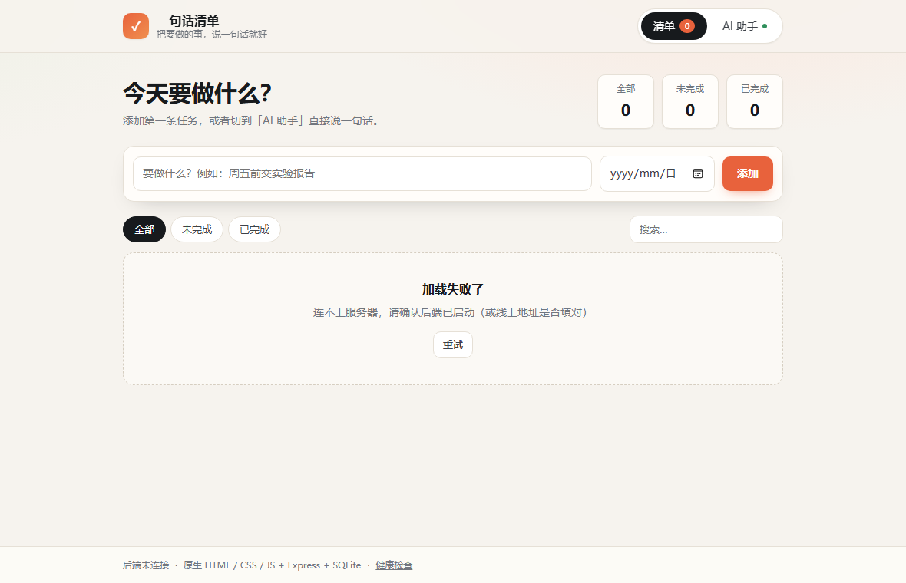
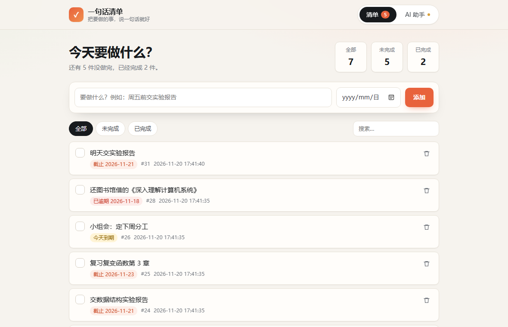

# 事故记录

> 五起真实发生在开发过程中的问题。每一条都按「现象 → 定位 → 修复 → 验证」写，附证据位置。
> 答辩第 3 问「哪里最容易坏、你怎么发现的」，答案就在这里面。

---

## 事故 1 · CORS：前端 5055 调后端 3100，一条请求都发不出去

**现象**

前端单独跑在 `http://127.0.0.1:5055`，后端在 `3100`。打开页面，列表不显示，
界面进入错误态，DevTools Console 全红：

```
Access to fetch at 'http://127.0.0.1:3100/api/items' from origin 'http://127.0.0.1:5055'
has been blocked by CORS policy: Response to preflight request doesn't pass access control check:
No 'Access-Control-Allow-Origin' header is present on the requested resource.
```

Network 面板里那条 `api/items` 显示 `CORS error`，**状态码是空的**——请求根本没发出去。

**定位**

两个关键点：

1. 我的 fetch 带了 `Content-Type: application/json`，浏览器把它归为「非简单请求」，
   正式请求前会先发 `OPTIONS` 预检。
2. 服务端的 CORS 中间件只对白名单里的 origin 写 `Access-Control-Allow-Origin`。
   5055 不在白名单，预检响应 204 但**没有这个头**，浏览器直接拒绝后续请求。

用 curl 验证服务端本身是好的：

```bash
curl -i -X OPTIONS http://127.0.0.1:3100/api/items \
  -H "Origin: http://127.0.0.1:5055" -H "Access-Control-Request-Method: GET"
# 204，没有 Access-Control-Allow-Origin
```

所以问题不在代码逻辑，而在**白名单配置**。

**修复**

```bash
ALLOWED_ORIGINS=http://127.0.0.1:5055,http://localhost:3000 node server/index.js
```

代码在 `server/lib/http.js` 的 `corsMiddleware()`：命中白名单才设置四个头，
`OPTIONS` 直接 204 结束。没有改浏览器安全策略，没有用 `*` 通配（带 Cookie 时会失效，也不安全）。

**验证**

同样的页面刷新，Console 干净，列表正常渲染：

| 修复前 | 修复后 |
|---|---|
|  |  |

Console 原文存于 `docs/evidence/11-cors-error.log.txt`。

**经验**：CORS 报错信息永远只说「没有 ACAO 头」，但原因可能是白名单、路径前缀、
反向代理吞头、或者 500 响应里没有头。先用 `curl -i -X OPTIONS` 看服务端到底回了什么，
一秒分清「服务端没给」还是「浏览器不让」。

---

## 事故 2 · 每个流式请求刚开始就被自己掐断

**现象**

第一次联调 `/api/chat`，前端只收到 `{"type":"meta"}`，紧接着就是 `{"type":"aborted"}`，
一个字都没流出来。但用 curl 直接请求是正常的。

**定位**

一开始我在路由里写了：

```js
req.on('close', () => controller.abort());   // ❌
```

想的是「浏览器断开 → 中断上游模型请求」。但 Node 的 `IncomingMessage` 上，
`close` 在**请求体读完**时就会触发（不是连接断开时才触发），
于是一个正常的 POST 请求刚进来就被判定为用户取消，上游请求立刻被 abort。

**修复**

改成监听**响应**的 `close`，并用 `writableEnded` 区分「正常结束」和「提前断开」：

```js
res.on('close', () => {
  if (!res.writableEnded) controller.abort();   // ✅ 只有没写完才说明是用户断开
});
```

**验证**

- 正常请求：`meta → delta… → done`，无 `aborted`。
- 点「停止生成」：前端 AbortController 断开连接 → 服务端 `res.on('close')` 触发 →
  `controller.abort()` → 上游 fetch 抛 AbortError → 事件流以 `aborted` 收尾，不再计费。

**经验**：`req` 和 `res` 的 `close` 语义不一样。
SSE 场景要关心的是「响应还能不能写」，所以监听 `res`。

---

## 事故 3 · 工具选错：问「还有哪些没做完」，却去调了「标记完成」

**现象**

对着 AI 说「我还有哪些没做完」，返回：

```
没办成：没有找到包含「我还有哪些没」的未完成条目
```

它没有去**查**清单，而是把整句话当成关键词去**标记完成**了——工具选错。

**定位**

演示模式的意图判断是一串正则，我最初把「完成」写在「查询」前面：

```js
if (/(完成|做完|搞定)/.test(text)) → complete_item     // ❌ 先匹配完成
else if (/(还有|哪些|查)/.test(text)) → query_items
```

「没**做完**」里含「做完」，于是先命中了「标记完成」分支，关键词还被切成了半句话。

顺带暴露第二个问题：提问里的「没做完」没有被识别成过滤条件，查询会返回全部而不是未完成。

**修复**

三步：

1. **调整优先级**：先判「查询意图」，再判「完成意图」；
2. **加否定词**：`没做完 / 没完成 / 未完成 / 还没 / 还剩` 一律归到「查询未完成」；
3. **加参数默认值**：这类问法自动带上 `done: 0`，不用用户说「只看未完成」。

```js
const isQuery = /(还有|有哪些|多少|查一下|看看|清单|列表|待办|还剩)/.test(text)
  || /(没做完|没完成|未完成|还没)/.test(text);
const isComplete = !isQuery && /(完成|做完|搞定|勾掉|办完)/.test(text);
```

**验证**

```
我还有哪些没做完  → query_items({done:0})    → 一共 4 条：⬜ #28 … ⬜ #26 …
查一下实验报告    → query_items({keyword:"实验报告"}) → 找到 2 条
把实验报告勾掉    → complete_item({keyword:"实验报告"}) → 已完成 #31「明天交实验报告」
```

**这条对真模型的启示**（配 Key 后要重点看的地方）：

模型选错工具，八成不是模型笨，而是**工具描述没写清楚**。所以 `server/ai/tools.js` 里：

- `add_item.description` 明确写「用户说『帮我记/加一条/提醒我』时**必须**调用本工具，不要只用文字答应」；
- `title` 字段单独写了「只保留要做的事，去掉指令词」；
- `add_item` 的 `title` 设为 `required`；
- 温度调到 `0.2`，别让它在工具调用上发挥。

如果真模型还是只用嘴答应不调工具，按这个顺序排查：
描述太短 → 没加 required → 没给强制语 → 温度太高 → 用了 reasoner 模型。

---

## 事故 4 · 不传截止日期就 400，测试救了一命

**现象**

`npm test` 第一次跑，14 条里挂 4 条：

```
POST /api/items -> 400
{"code":40004,"data":null,"msg":"due 必须是 YYYY-MM-DD 格式的字符串"}
```

请求体是 `{"title":"复习复变"}`——**根本没传 due**，却被当成格式错误。

**定位**

```js
function parseDue(raw) {
  if (raw === null || raw === '') return null;   // ❌ 漏了 undefined
  if (typeof raw !== 'string') throw badRequest(...);
}
```

`undefined` 既不等于 `null` 也不等于 `''`，直接落到类型检查里被拦下。
前端表单没填日期时 `payload.due` 是直接不带的，所以「不加日期」这个最常见的操作反而必坏。

**修复**

```js
if (raw === undefined || raw === null || raw === '') return null;
```

**验证**

```bash
npm test
# ℹ tests 14  ℹ pass 14  ℹ fail 0
```

**经验**：`undefined` / `null` / `''` 是三个不同的东西。
接口层的「可选字段」必须在入口处归一化，否则错误会一路渗到业务逻辑里。
如果没有自动化测试，这个 bug 会活到答辩现场——评委随手点一下「只填标题」就复现。

---

## 事故 5 · 端口 3000 被占：`EADDRINUSE`

**现象**

```
Error: listen EADDRINUSE: address already in use :::3000
```

**定位**

之前那个项目的服务还在后台跑着，占着 3000。更坑的是：浏览器打开 `localhost:3000`
看到的是**旧项目**的页面，接口返回的也是旧数据，一开始还以为是新代码没生效。

**修复**

```bash
# 看谁占着
netstat -ano | findstr :3000
taskkill /PID <pid> /F
```

开发期换个端口也行：`PORT=3100 npm start`。

**验证**

`curl http://127.0.0.1:3100/api/health` 返回 `{"status":"up","mode":"mock",...}`，
与旧服务的返回结构完全不同，确认连的是新进程。

**经验**：改完代码没效果，先怀疑「你看的不是你以为的那个服务」。
`/api/health` 里带上 `uptime` 和 `mode`，一眼就能认出是哪个进程。
